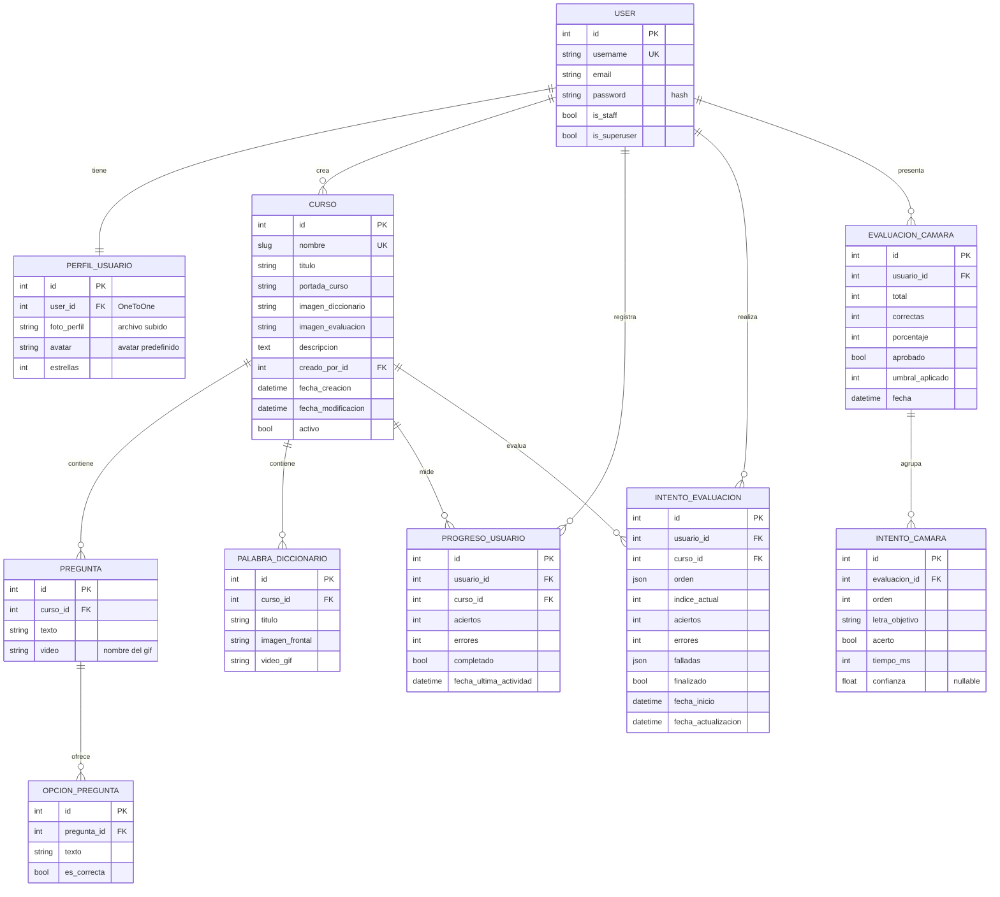

# Modelo de datos

## Diagrama entidad-relación

---

## Diccionario de datos

### `PerfilUsuario` (app `usuarios`)

Extiende al `User` de Django sin reemplazarlo. Se crea automáticamente por
señal cada vez que nace un `User`, incluidos los creados desde el admin.

| Campo | Tipo | Nulo | Descripción |
|---|---|---|---|
| `user` | OneToOne → User | No | Usuario dueño del perfil. Borrado en cascada. |
| `foto_perfil` | ImageField | Sí | Foto subida por el usuario. Se guarda en `MEDIA_ROOT/fotos_perfil/`. |
| `avatar` | CharField(100) | No | Nombre de un avatar predefinido del frontend. |
| `estrellas` | PositiveInteger | No | Cursos completados. Se recalcula al cerrar cada evaluación. |

### `Curso` (app `cursos`)

| Campo | Tipo | Nulo | Descripción |
|---|---|---|---|
| `nombre` | SlugField único | No | Identificador usado en las URLs del frontend. |
| `titulo` | CharField(100) | No | Nombre visible del curso. |
| `portada_curso` | CharField(255) | No | Archivo de portada en `assets/imagenes/`. |
| `imagen_diccionario` | CharField(255) | No | Imagen de la tarjeta de diccionario. |
| `imagen_evaluacion` | CharField(255) | No | Imagen de la tarjeta de evaluación. |
| `descripcion` | TextField | Sí | Texto descriptivo del curso. |
| `creado_por` | FK → User | Sí | Autor. `SET_NULL` si se borra el usuario. |
| `fecha_creacion` | DateTime | No | Se fija al crear. |
| `fecha_modificacion` | DateTime | No | Se actualiza en cada guardado. |
| `activo` | Boolean | No | Solo los activos aparecen en el catálogo público. |

### `Pregunta`

| Campo | Tipo | Nulo | Descripción |
|---|---|---|---|
| `curso` | FK → Curso | No | Cascada. |
| `texto` | CharField(200) | No | Enunciado. |
| `video` | CharField(255) | Sí | Gif de la seña, en `assets/videos/`. |

### `OpcionPregunta`

| Campo | Tipo | Nulo | Descripción |
|---|---|---|---|
| `pregunta` | FK → Pregunta | No | Cascada. |
| `texto` | CharField(100) | No | Texto de la alternativa. |
| `es_correcta` | Boolean | No | Solo una por pregunta, garantizado en el serializer. |

Regla de negocio: máximo 4 opciones por pregunta.

### `PalabraDiccionario`

| Campo | Tipo | Nulo | Descripción |
|---|---|---|---|
| `curso` | FK → Curso | No | Cascada. |
| `titulo` | CharField(100) | No | Palabra o letra. |
| `imagen_frontal` | CharField(200) | No | Cara frontal de la tarjeta. |
| `video_gif` | CharField(200) | No | Cara trasera: gif de la seña. |

### `ProgresoUsuario`

Resultado consolidado del último intento terminado. Restricción de unicidad
sobre `(usuario, curso)`.

| Campo | Tipo | Nulo | Descripción |
|---|---|---|---|
| `usuario` | FK → User | No | Cascada. |
| `curso` | FK → Curso | No | Cascada. |
| `aciertos` | PositiveInteger | No | Aciertos en primer intento. |
| `errores` | PositiveInteger | No | Fallos acumulados. |
| `completado` | Boolean | No | `True` al terminar la evaluación. |
| `fecha_ultima_actividad` | DateTime | No | Última actualización. |

### `IntentoEvaluacion`

Estado de una evaluación en curso. Sustituye a las variables que el monolito
guardaba en `request.session`.

| Campo | Tipo | Nulo | Descripción |
|---|---|---|---|
| `usuario` | FK → User | No | Cascada. |
| `curso` | FK → Curso | No | Cascada. |
| `orden` | JSONField | No | IDs de preguntas en orden aleatorio. |
| `indice_actual` | PositiveInteger | No | Posición dentro de `orden`. |
| `aciertos` | PositiveInteger | No | Contador de aciertos válidos. |
| `errores` | PositiveInteger | No | Contador de fallos. |
| `falladas` | JSONField | No | IDs fallados al menos una vez. |
| `finalizado` | Boolean | No | `True` cuando se cierra el intento. |
| `fecha_inicio` | DateTime | No | Creación del intento. |
| `fecha_actualizacion` | DateTime | No | Última respuesta registrada. |

Solo puede haber un intento con `finalizado = False` por usuario y curso;
`iniciar/` elimina el anterior antes de crear uno nuevo.

### `EvaluacionCamara` (app `evaluacion_camara`)

Una sesión de la evaluación con cámara. Todos los campos numéricos y
`aprobado` los calcula el servidor a partir de los intentos.

| Campo | Tipo | Nulo | Descripción |
|---|---|---|---|
| `usuario` | FK → User | No | Cascada. |
| `total` | PositiveInteger | No | Número de intentos. |
| `correctas` | PositiveInteger | No | Intentos con `acerto = True`. |
| `porcentaje` | PositiveInteger | No | `correctas * 100 // total`. |
| `aprobado` | Boolean | No | `correctas * 100 >= umbral_aplicado * total`. |
| `umbral_aplicado` | PositiveInteger | No | Umbral vigente al guardar (configurable, por defecto 70). |
| `fecha` | DateTime | No | Creación de la sesión. |

### `IntentoCamara`

Una letra intentada dentro de una sesión.

| Campo | Tipo | Nulo | Descripción |
|---|---|---|---|
| `evaluacion` | FK → EvaluacionCamara | No | Cascada. |
| `orden` | PositiveInteger | No | Posición dentro de la sesión (desde 0). |
| `letra_objetivo` | Char(2) | No | Letra pedida, en mayúscula. |
| `acerto` | Boolean | No | Lo decide el reconocedor del navegador. |
| `tiempo_ms` | PositiveInteger | No | Tiempo que tardó el intento. |
| `confianza` | Float | Sí | Confianza del clasificador, entre 0 y 1. |

---

## Reglas de integridad

1. Borrar un curso arrastra sus preguntas, opciones, palabras, progresos e
   intentos (cascada).
2. Borrar un usuario arrastra su perfil, progresos e intentos; los cursos que
   creó sobreviven con `creado_por = NULL`.
3. `Curso.nombre` es único y es la clave que usa el frontend en las URLs.
4. `(usuario, curso)` es único en `ProgresoUsuario`.
5. Los campos de imagen y video guardan nombres de archivo, nunca rutas
   absolutas ni URLs, para que el frontend pueda cambiar de CDN sin tocar la
   base de datos.

---

## Normalización

El esquema está en tercera forma normal:

- Cada tabla tiene clave primaria simple y atributos atómicos (1FN).
- No hay dependencias parciales: las únicas claves compuestas son restricciones
  de unicidad, no claves primarias (2FN).
- No hay dependencias transitivas: por ejemplo el título del curso no se repite
  en `Pregunta`, se obtiene por la clave foránea (3FN).

La única desnormalización deliberada es `PerfilUsuario.estrellas`, que es un
valor derivado de contar los `ProgresoUsuario` completados. Se mantiene
precalculado para evitar un `COUNT` en cada carga de la cabecera.
